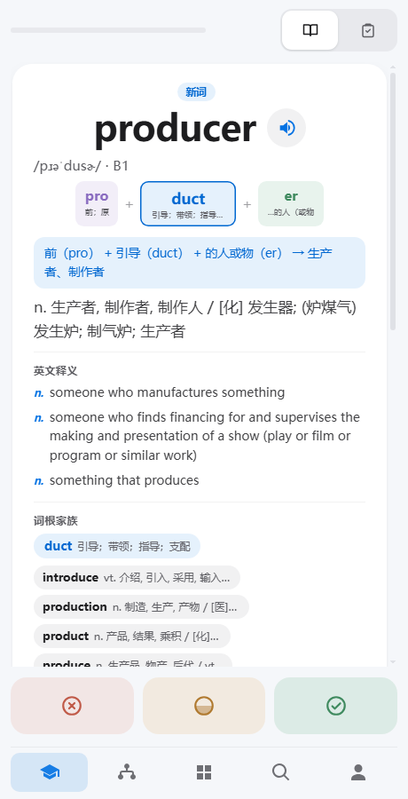
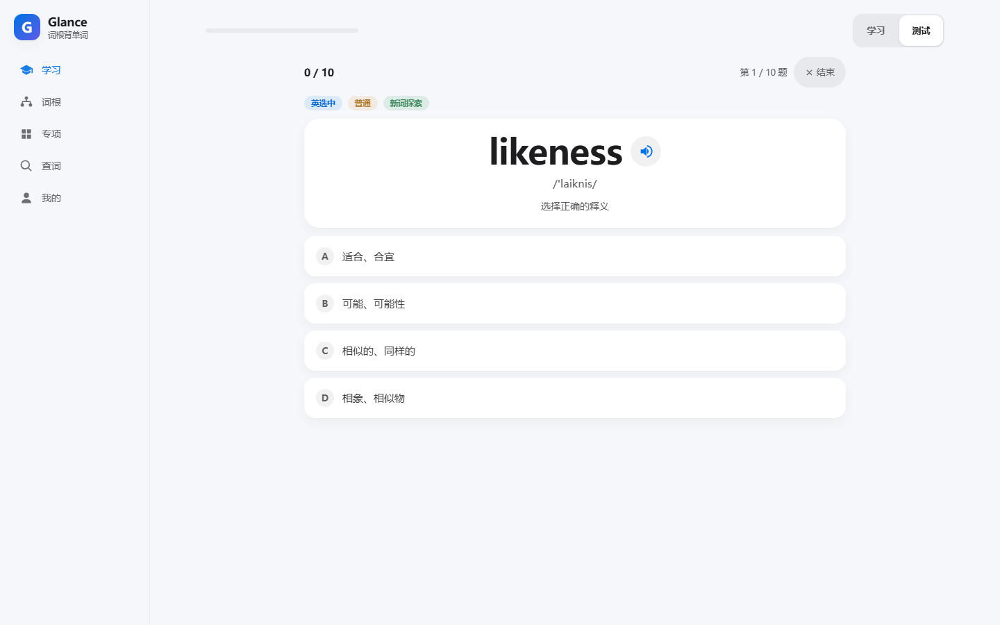
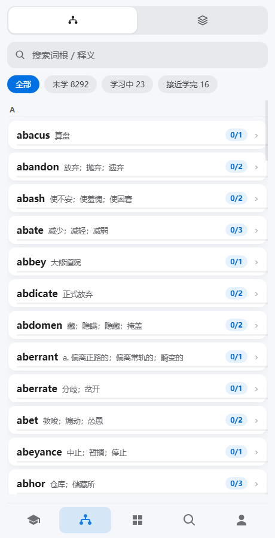
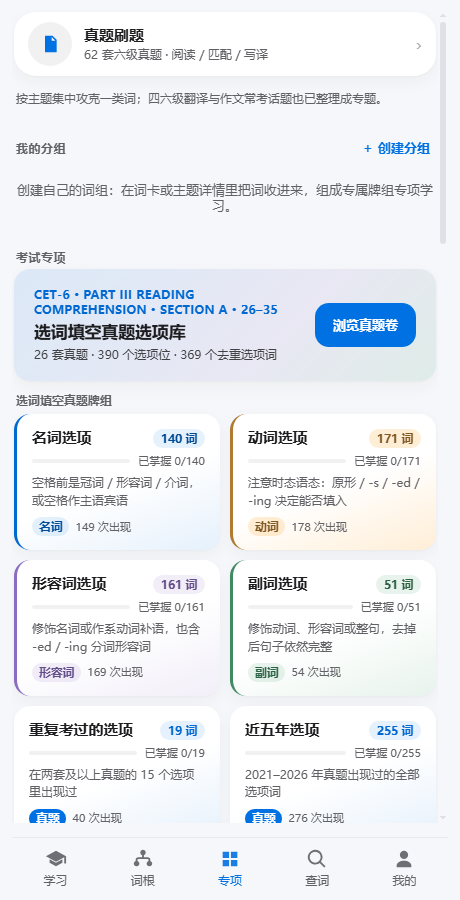
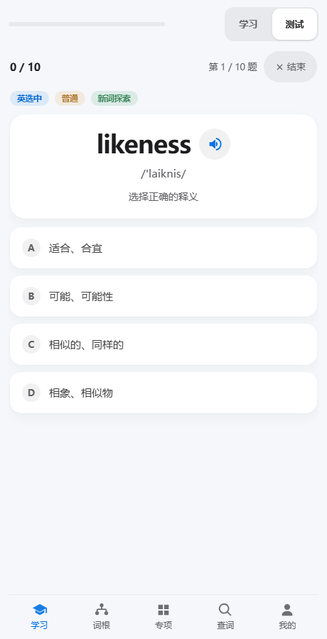
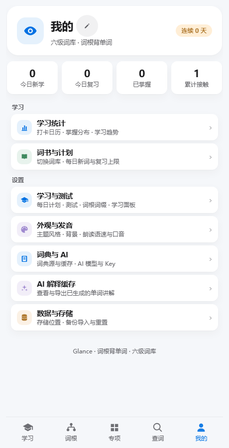

# Glance

> 以词根助记为核心的英语词汇学习应用 · 同一套 Web 核心运行于 Windows（Electron）、Android（Capacitor）与浏览器

[](https://github.com/mjkyleo/Glance/actions/workflows/android-build.yml)
[](https://github.com/mjkyleo/Glance/releases/latest)

Glance 把「词根分解 + 词性详解 + FSRS-6 记忆调度」放在学习页中心，用你的全部学习记录驱动复习与测试：到期、薄弱、易混、收藏决定考什么，答错误选的词会成为下一轮的干扰项。离线可用、数据只存本机、备份可迁移。

## 功能亮点

- **记忆调度**：FSRS-6 自适应间隔复习，认识 / 模糊 / 忘记三档评分，每日新词与复习计划。
- **词根助记**：词根分解、词根家族、词缀导航；默认按家族词数降序并隐藏小众词根（可切字母序/显示全部），按学习状态四类筛选 + 字母分组吸顶，滚动按需加载全量词根。
- **专项学习**：29 个主题 + 自定义词组；六级选词填空真题牌组与 62 套真题刷题（年份折叠网格、选词填空词库刷法，部分套含官方答案自动判分）。
- **AI 学习空间**：全屏导学——先确认学习计划（时长/重点/教学策略），AI 按策略逐步讲解 + 即时检查 + 随步问答，完成学习后才生成每日报告；中断可续学；还能把学过的词写成一篇可选字数的「印象文章」，目标词高亮可点、附中文译文。
- **翻译与写作材料**：六级翻译 9 篇、六级写作 77 篇、四级写作 12 篇与积累素材 25 块（study.json 单源懒加载），背诵模式逐块揭示，真题详情直达对应参考资料。
- **行为驱动测试**：组卷与干扰项来自学习记录（含误选易混对），保留可调的新词探索比例；四种题型、自动难度、来源徽标与结果构成分析。
- **学习页 16 个信息块**：音标、构词、助记、释义、例句、词源、真题词频等逐项开关与排序；与 AI 详解同一编辑式版式（蓝色块标题、衬线英文例句带左竖线与中文译文、中点词表），构词合并为单词下方单行大字、前缀/词根/后缀三色、释义列下对齐；词库缺例句时由 AI 缓存补充并标来源。
- **查词与词典**：本地词库 + 多词典并行合并去重 + 任意自定义 JSON 端点；可选 AI 深度讲解。
- **发音**：真人音频优先，缺失回退系统 TTS，语速 / 口音可调。
- **外观**：8 套设计语言主题 × 浅 / 深色，自定义背景壁纸；桌面浏览器自动切换侧栏宽布局。
- **加载动效**：定制 monoline「glance」荧光白字标，极柔和波浪行波与双层柔光，深墨品牌画布；幕布上移交错进入学习页，reduced-motion 降级静态。
- **界面**：功能入口整页右滑入、返回箭头回退；多级面包屑跳级；图标优先的极简文案，底栏滑动指示 + 涟漪点按反馈；学习记录时间轴与查词历史日期分组。
- **数据**：本地持久化，通用 JSON 备份导出 / 导入；Android 共享目录镜像，卸载重装可恢复。

## 截图

| 移动端学习页 | 桌面端学习页 |
| --- | --- |
|  |  |

| 词根分类 | 专项分类 | 测试会话 | 我的 |
| --- | --- | --- | --- |
|  |  |  |  |

## 快速开始

### 浏览器

```bash
git clone https://github.com/mjkyleo/Glance.git
cd Glance
npx serve app          #或：python -m http.server 8080 -d app
```

打开 http://localhost:8080 。数据保存在站点 localStorage，请定期导出备份。

### Windows

从 [Releases](https://github.com/mjkyleo/Glance/releases/latest) 下载 `glance-setup-*.exe` 安装。未做代码签名，SmartScreen 提示时选「更多信息 → 仍要运行」。

### Android

从 [Releases](https://github.com/mjkyleo/Glance/releases/latest) 下载 `Glance-android.apk`（GitHub Actions 自动构建），允许「安装未知应用」后安装。

> 从旧调试版首次迁移到私有签名 release：先「我的 → 数据备份」导出并确认文件可读取，再卸载旧版、安装并导入；不要只依赖共享镜像。API Key 不在备份中，需重新填写；头像与背景也需重新设置。此后同一私有签名可覆盖升级。

## 使用概览

1. **学习**：首页按计划推送新词与到期复习，三档评分更新记忆状态；信息块开关与顺序在「我的 → 学习」统一调整。
2. **词根 / 专项**：底栏浏览词根词缀与主题词表，可整主题或自定义词组专项学习。
3. **测试**：学习页顶部切「测试」；范围 / 题量 / 题型 / 难度 / 组卷依据在齿轮面板调整。答对约 1 秒自动下一题，答错展开全部词义并收入错题本；键盘 `1–4` 选项、`Enter` 继续、`S` 朗读。
4. **查词**：搜索单词 / 词根 / 词缀；未收录词提供在线查词并缓存；词典源与 AI 在「我的」配置。
5. **我的**：统计、词书与计划（含考纲对比）、AI 解释库与全部设置；头像昵称可编辑。
6. **备份**：「我的 → 数据备份」导出 / 导入 JSON（合并 / 覆盖），查看与更改存储位置。

## 数据与隐私

- 学习数据只存本机：Windows 默认 `%APPDATA%/glance`（可改目录），Android 私有空间 + `Documents/Glance` 共享镜像，浏览器 localStorage。
- 导出为通用 JSON：`words` 表可直接转 CSV 分析，`data` 块无损恢复；**导出不含任何 API Key**。
- API Key 在 Windows 以 AES-256-GCM 加密落盘，解密密钥仅留本机私有目录；Android / 浏览器仅存私有空间。
- 背景图片与头像只存本机，不进入备份文件。

完整 schema 与平台差异见 [docs/DATA.md](docs/DATA.md)。

## 项目结构

```
app/            共享 Web 核心（index.html / css / js / data 索引化词库）
main.js         Electron 主进程（窗口、IPC、加密、原生网络通道）
android/        Capacitor Android 工程（含 GlanceStorage 共享存储镜像插件）
scripts/        词库与真题数据构建、验收门、开发启动器
assets/words/   考纲词表、真题语料词频与选词填空源数据
docs/           FEATURES.md 功能全景 / DATA.md 数据规范 / LOGO-SPEC.md / 截图
DEVELOPMENT.md  开发过程、逐功能验证与变更日志
```

## 开发

```bash
npm install
npm start                # Electron 开发运行
npm run build            # Windows 安装包
npx cap sync android     # 同步 Web 核心到 Android 工程
npm run data:frequency   # 真题词频（须先跑）
npm run data:cloze       # 选词填空牌组
npm run data:exams       # 62 套真题分片
node scripts/verify-panel-order.js     # 学习面板验收门
node scripts/verify-single-source.js   # 单一解释源验收门
node scripts/verify-custom-compat.js   # 自定义词书兼容验收门
```

推送 `main` 后 [android-build.yml](.github/workflows/android-build.yml) 构建私有签名 release APK，发布为 `android-<构建号>` 并附 SHA-256 校验文件；缺少签名 Secrets 会停止构建。首次配置与升级注意事项见 [DEVELOPMENT.md §8.53](DEVELOPMENT.md#853-正式发布版本与私有签名改造待-ci--真机验证)。文档与认知资产提交不触发构建。

## 文档

- [docs/FEATURES.md](docs/FEATURES.md) — 逐模块功能全景与迭代规划
- [docs/DATA.md](docs/DATA.md) — 词库组织、导入格式、存储与备份 schema
- [DEVELOPMENT.md](DEVELOPMENT.md) — 开发清单、实现验证与 Git 变更日志
- [docs/LOGO-SPEC.md](docs/LOGO-SPEC.md) — Logo 几何与图标规范

## License

ISC