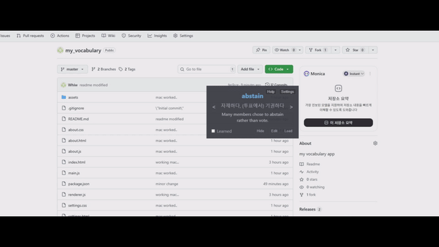

# Glance


*A tiny, always-on-top overlay flashcard app for effortless vocabulary learning while you work or browse.*

[➡️ Download (Windows / macOS) - Releases](https://github.com/mjkyleo/Glance/releases)

---

## ✨ Features

- **Overlay window** that stays on top of other apps (drag & resize freely)
- **Auto-cycling words** on a timer (hover to pause; click to skip)
- **Mark as Learned** to hide words you’ve mastered
- **Multi-language UI (EN/ZH)**
- **Example sentence support**  
  Format: `word[TAB]meaning[TAB]example sentence`
- **Built-in sample TSV**
- **Lightweight** (bundled Chromium & Node)
- **Cross-platform**: Windows & macOS supported 🎉

> ⚠️ **Note about full-screen games**  
> Some games use *exclusive fullscreen (DirectX/OpenGL/Vulkan)*.  
> In that mode overlays cannot draw on top.  
> Switch to **borderless windowed (fullscreen)** mode instead.

---

## 📥 Installation

1. Download the latest installer from **[Releases](https://github.com/mjkyleo/Glance/releases)**.
2. Run the installer (`.exe` on Windows, `.dmg` or `.zip` on macOS).
3. Go to **Load** and select your `.tsv` file.

> ℹ️ On Windows, SmartScreen may show a warning if the app is unsigned.  
> Click **More info → Run anyway** to proceed.

> ℹ️ On macOS, you may need to **allow apps from unidentified developers** in **System Settings → Privacy & Security**.

---

## 🚀 How to Use

1. **Load a TSV**  
   - File format:  
     ```
     word[TAB]meaning
     word[TAB]meaning[TAB]example sentence
     ```
   - Example:  
     ```
     abate   reduce in amount or intensity   The storm suddenly abated.
     candid  straightforward and honest     She was candid about her feelings.
     sagacious   wise; having sound judgment   The sagacious leader guided them well.
     ```

2. **Learn flow**  
   - Words cycle automatically.  
   - Hover mouse to pause timer.  
   - Use **<** and **>** to navigate manually.  
   - Check **Learned** to hide a word (saved to `learned.json`).  

3. **Customize**  
   - Open **Settings** to change timer speed, font sizes, colors, and manage learned words.  

---

## 🔄 Auto-Update

- Checks GitHub Releases for new versions on launch.  
- Downloads & applies automatically if found.  
- Works on both Windows and macOS.

---

## 🌐 Language Support

- **English** and **中文（简体）** supported.  
- Switch language from **Settings** or **About**.

---

## 🛠 Build (for Developers)

**Requirements:** Node.js & npm

```bash
# Install deps
npm install

# Run dev
npm start

# Build (electron-builder)
npm run build
```

> ℹ️ **Windows 上启动失败？**
> `npm start` 会先自动创建用户数据目录（`%APPDATA%\glance`，缺失时 Electron 会启动即崩）；
> 若进程在 3 秒内静默退出（本机 Chromium 沙箱初始化失败），它会自动改用 `--no-sandbox` 重试。
> 需要强制走无沙箱模式时可继续使用 `npm run start:win`。